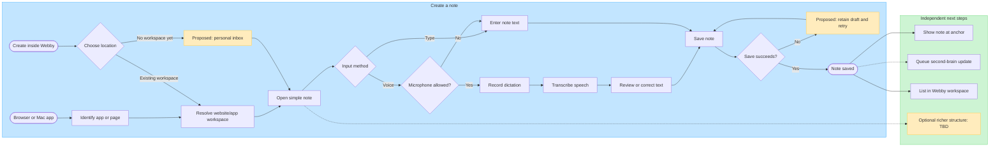
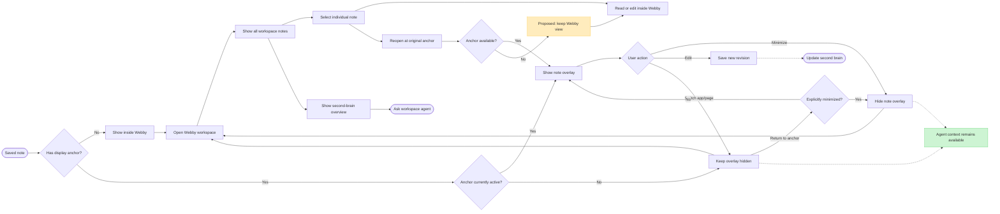
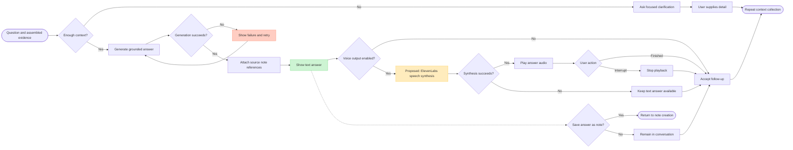

# Webby product pipeline — proposed product specification

This describes the intended product, not a claim that the current code implements it. The README currently describes sticky notes attached to Mac apps or exact Chrome pages. The flows below expand the user's product direction. `Proposed` identifies added behavior; `TBD` identifies decisions still needed.

## Confirmed rules

- Users create notes from a browser/app or inside Webby. Typing and voice are supported entry methods.
- Each Webby tab is a website/app workspace. Individual pages/documents live inside that workspace.
- A note's anchor controls where it appears. Workspace membership controls which second brain it belongs to. These are separate concepts.
- Hidden, occluded, and minimized notes remain available in Webby and in the workspace's agent context.
- Each workspace exposes its collected notes and a context-rich conversational voice agent.
- The agent uses relevant notes and, when asked with screen access enabled, current screen context. Continuous capture is outside this agreed flow.
- Simple note taking is the default; richer structure is optional, with its exact feature set TBD.

## Reading the diagrams

Read diagrams 1–5 in order. Solid arrows show flow; dashed arrows show asynchronous or optional steps. Yellow nodes identify proposals or unresolved decisions. A saved note and an AI-ready note are separate states: saving must not depend on AI processing succeeding.

## 1. Note creation

Notes created inside Webby require a workspace choice or the proposed personal inbox. An unanchored note appears in Webby until the user attaches it to an app/page. Voice transcription failure retains the editable draft and offers retry or typing. Autosave timing versus an explicit Done action is TBD.

## 2. Display, minimize, and reopen

Proposed restoration rule: switching away temporarily hides an overlay; returning restores it unless the user explicitly minimized it. A covered note and a minimized note can have different UI states, but neither loses workspace membership. Reopening does not create a duplicate note. Behavior when the original app is closed or the page moved is TBD; reading inside Webby remains the proposed fallback.

## 3. Second-brain processing — proposed implementation

```mermaid
flowchart LR
change(["Note saved or changed"]) --> original["Store original and revision"]
original --> assign["Resolve owner and workspace"]
assign --> pending["Mark context updating"]
pending -.-> job["Process note revision"]
job --> split["Split into retrievable pieces"]
split --> provenance["Attach note and source references"]
provenance --> index["Update retrieval index"]
index --> summarize["Refresh derived workspace overview"]
summarize --> current{"Revision still current?"}
current -->|"Yes"| publish["Publish context version"]
current -->|"No"| newer["Process newest revision"]
newer --> job
publish --> ready(["Context ready"])
job -->|"Processing failure"| failed["Show update failure"]
failed --> retry["Retry processing"]
retry --> job
failed --> usable["Original note stays usable"]
ready --> inspect["Inspect overview and source notes"]
ready --> retrieve(["Available to workspace agent"])
remove(["Note deleted or moved"]) --> invalidate["Invalidate old retrieval pieces"]
invalidate --> rebuild["Refresh affected workspace overview"]
rebuild --> pending
hide(["Note minimized or occluded"]) --> unchanged["No context removal"]
unchanged --> retrieve
style pending fill:#FFECBD,stroke:#FFC943
style failed fill:#FFCDC2,stroke:#FF7556
style ready fill:#CDF4D3,stroke:#66D575
```

The second brain is a derived, inspectable view of workspace notes, not a destructive replacement for them. Retrieval pieces retain note ID, revision, workspace, and source reference. An overview is a convenience; agent retrieval should preserve access to source notes. The proposed UI displays pending/ready/failed processing state and links each piece back to its note. Deleted, moved, or outdated pieces must be filtered from retrieval immediately while summaries catch up. Storage technology, retrieval strategy, synchronization, and offline behavior remain TBD.

## 4. Agent request and context collection

```mermaid
flowchart LR
ask(["Ask workspace agent"]) --> scope["Bind selected workspace"]
scope --> mode{"Question input"}
mode -->|"Text"| question["Question text"]
mode -->|"Voice"| mic{"Microphone allowed?"}
mic -->|"No"| typed["Offer typed question"]
typed --> question
mic -->|"Yes"| speech["Capture utterance"]
speech --> stt["Speech to text"]
stt --> question
question --> notes["Retrieve relevant workspace notes"]
notes --> freshness["Check revisions and indexing state"]
freshness --> screen{"Screen access enabled?"}
screen -->|"No"| absent["Use notes only"]
screen -->|"Yes"| capture["Capture current view on request"]
capture --> captured{"Capture succeeded?"}
captured -->|"No"| absent
captured -->|"Yes"| identity["Attach app/page and capture time"]
identity --> vision["Proposed: Gemini interprets view"]
vision --> observed["Structured screen observations"]
vision -->|"Provider failure"| absent
observed --> assemble["Assemble question and evidence"]
absent --> assemble
freshness -.-> assemble
assemble --> handoff(["Continue to answer flow"])
style vision fill:#FFECBD,stroke:#FFC943
style absent fill:#FFECBD,stroke:#FFC943
```

Proposed context contract: question text, selected workspace ID, relevant note excerpts with IDs/revisions, optional screen observations with app/page identity and capture time, and the active conversation history. Record unavailable or stale inputs explicitly. If the displayed app/page differs from the selected workspace, ask which scope to use before blending evidence. Screen content is evidence, not an instruction source. Screen capture is a client capability; Gemini is the proposed interpretation step after capture, not the mechanism that grants access to the user's screen. Specific provider APIs and models need technical validation before implementation.

## 5. Answer, voice playback, and follow-up

The language model generates the answer; text-to-speech speaks it. Speech-to-text belongs before interpretation for spoken questions and dictated notes. ElevenLabs is a candidate, not a finalized dependency. A voice failure must not discard a successful text answer. Proposed answer behavior distinguishes note evidence, current-screen observations, and uncertain inferences about user struggles. It should not present inferred struggles as established facts. Follow-up context is scoped to the active workspace; conversation persistence and cross-workspace access remain TBD. Saving an answer is an explicit user action, preventing AI replies from silently becoming source notes.

## Proposed granularity and ownership

| Concept | Meaning | Important boundary |
| --- | --- | --- |
| User | Owner of notes and workspaces | Agent retrieves only authorized notes |
| Workspace | A website/app collection represented by a Webby tab | Domain, subdomain, account, and app-project grouping rules TBD |
| Source | A specific page or app document | Stable identity and URL normalization TBD |
| Note | Original editable content, with a revision | One primary workspace proposed; multi-workspace notes TBD |
| Anchor | Where the overlay appears | Independent of agent inclusion and workspace grouping |
| Visibility | Visible, minimized, or temporarily hidden | No change to second-brain membership |
| Context piece | Retrievable excerpt linked to its source note | Derived and replaceable; never the sole original |
| Workspace overview | Derived view of the collection | Links back to contributing notes |
| Screen snapshot | Current view captured for a question | Retention and capture boundary TBD |
| Conversation | Questions, context, and responses | Session scope and history retention TBD |

## Decisions still needed

1. **Website/app identity:** group by domain, subdomain, logged-in account, or project? For example, do two accounts on the same website share a workspace?
2. **Webby-only notes:** use a personal inbox, require a workspace, or support both? Does the inbox have its own agent?
3. **Richer note features:** select a small initial set such as formatting, checklists, links, tags, or attachments; avoid silently assuming Notion-style databases.
4. **Save and restore behavior:** autosave timing, Done behavior, overlay placement, and reopening unavailable anchors.
5. **Capture boundary:** active window, browser viewport, selected region, or another source? What happens if the user changes pages while the answer is generated?
6. **Agent scope:** current workspace only by default is proposed. Explicit cross-workspace requests and persistent conversation history need a decision.
7. **Storage and retention:** local/cloud notes, sync, offline retry, audio/screenshot retention, and deletion propagation.
8. **Optional exclusion:** hiding is confirmed to retain agent access. A separate exclude-from-agent control is not yet a confirmed feature.
9. **Provider roles:** validate screen interpretation, reasoning model, speech recognition, and synthesis independently; decide whether one provider handles multiple stages.

## Walkthroughs for review

- Dictate a note on a Chrome page, save it, minimize it, and open its website workspace: the note is listed and remains eligible for agent retrieval.
- Create a note directly in Webby without an app/page: it remains readable even without an overlay anchor; its workspace/inbox placement follows the pending decision.
- Ask a question with screen access disabled: use workspace notes and state the missing screen context when relevant.
- Ask with screen access enabled: capture only for that request, attach source identity/time, and combine the interpretation with relevant notes.
- Change or delete a note while indexing runs: stale revisions cannot become the current context or remain eligible for retrieval.
- Fail transcription, capture, reasoning, or speech synthesis independently: preserve the note/question or successful text answer and offer the appropriate fallback.
- Switch workspace during a conversation: keep the request bound to its original scope or explicitly start a request in the new scope.
